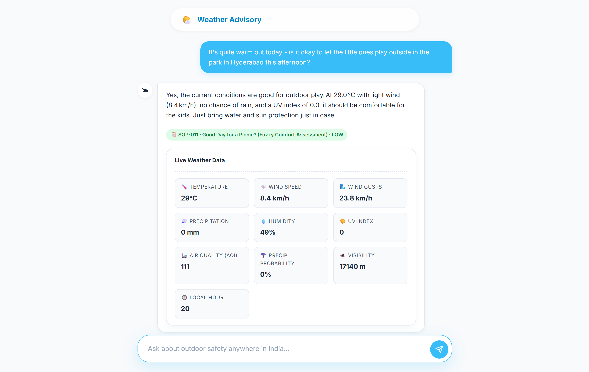
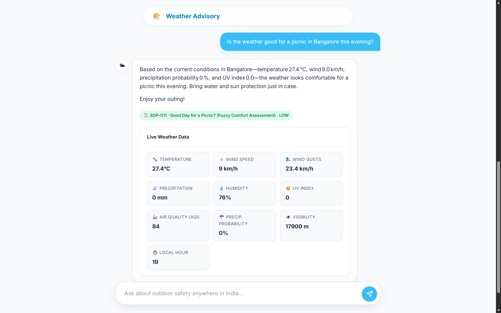
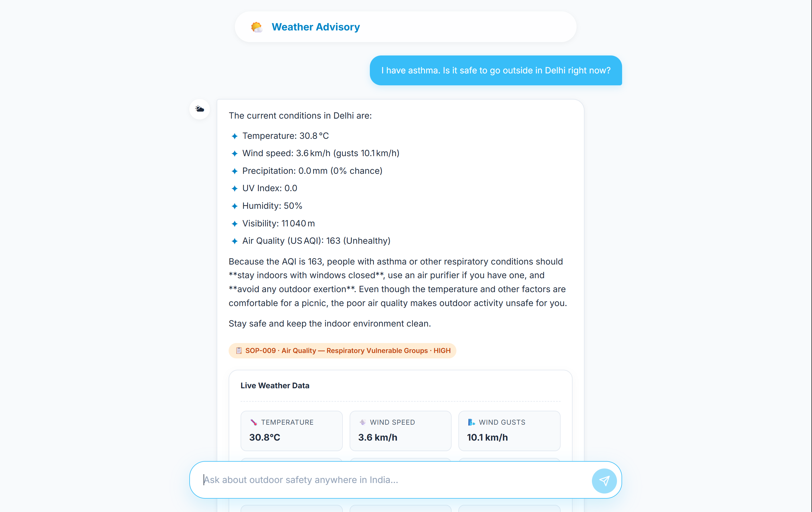
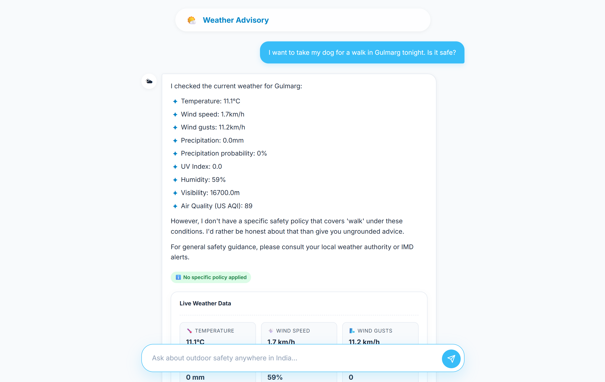

#  Weather-Advisory Support Bot

A smart, conversational chatbot that provides personalized outdoor activity safety advice across India. It leverages live weather data from Open-Meteo and strictly follows predefined safety policies (SOPs) to ensure you stay safe while planning your day. Built with **LangGraph** and **FastAPI**.


Live Demo: https://weather-advisor-ai-production.up.railway.app/

---

## Screenshots

Here are some glimpses of Weather Advisory in action:









---

##  Features

- **Conversational Interface:** Natural language understanding for diverse user queries.
- **Live Weather Integration:** Fetches real-time weather data and forecasts via the Open-Meteo API.
- **Policy-Driven (SOPs):** Uses strictly defined safety policies covering heat, UV, wind, rain, and vulnerable groups.
- **Explainable Advice:** Always cites the specific SOP applied and displays the exact weather metrics used.
- **Fail-Safe Mechanism:** Gracefully handles API failures and explicitly states when no specific policy applies.
- **Beautiful UI:** A modern, clean frontend built with Vanilla JS and CSS.

---

##  Tech Stack

- **Backend:** Python, FastAPI, Uvicorn
- **AI & Logic:** LangChain, LangGraph, OpenAI Models
- **Frontend:** HTML5, CSS3, Vanilla JavaScript
- **Data Source:** Open-Meteo API (Geocoding & Weather)

---

##  Setup & Installation

### 1. Clone the repository
```bash
git clone https://github.com/your-username/Weather-Advisory-Bot.git
cd Weather-Advisory-Bot
```

### 2. Set up Virtual Environment
```bash
python -m venv venv
# Windows
venv\Scripts\activate
# Mac/Linux
source venv/bin/activate
```

### 3. Install Dependencies
```bash
pip install -r requirements.txt
```

### 4. Environment Variables
Create a `.env` file in the root directory:
```bash
copy .env.example .env
```
Edit `.env` and add your API keys (e.g., `FIREWORKS_API_KEY` or `OPENAI_API_KEY`).

---

##  Running the Application

Start the FastAPI backend server:
```bash
uvicorn backend.main:app --reload --port 8000
```
Then, open your browser and navigate to: [http://localhost:8000](http://localhost:8000)

---

##  Running Evaluations

The project includes an evaluation suite to test the bot's adherence to SOPs, handling of paraphrased intents, adversarial prompt injections, and API failures.

```bash
python -m evals.eval_suite
```
A detailed markdown report will be generated at `evals/results.md`.

---

##  How It Works (LangGraph Architecture)

The bot utilizes a directed acyclic graph (DAG) pipeline with 6 core nodes:

1. **`parse_query`**: The LLM analyzes the user's message to extract the target location, intended activity, and relevant keywords.
2. **`fetch_weather`**: Calls the Open-Meteo API to get coordinates and real-time weather data.
3. **`match_sops`**: A deterministic Python engine evaluates the weather data against predefined SOP thresholds.
4. **`generate_response`**: The LLM crafts a helpful response strictly grounded in the matched SOP and live data.
5. **`handle_weather_error`**: A fallback node that provides a graceful error message if the weather API fails.
6. **`handle_no_match`**: A fallback node that issues honest "no specific guidance" when the weather is benign or the activity is not covered by any SOP.

*Note: Critical threshold checks (e.g., `wind > 40 km/h`) are executed in pure code to guarantee deterministic safety compliance.*

---

##  Project Structure

```text
Weather-Advisory-Bot/
├── assests/              # UI screenshots
├── backend/
│   ├── main.py           # FastAPI application & endpoints
│   ├── graph.py          # LangGraph state machine definition
│   ├── weather.py        # Open-Meteo API integration
│   ├── sop_engine.py     # Deterministic SOP matching logic
│   └── state.py          # State schemas and typing
├── evals/
│   ├── eval_suite.py     # Automated evaluation cases
│   └── results.md        # Eval execution reports
├── frontend/
│   ├── index.html
│   ├── style.css
│   └── script.js
├── sops/
│   └── policies.yaml
├── .env.example
├── requirements.txt
└── README.md
```
